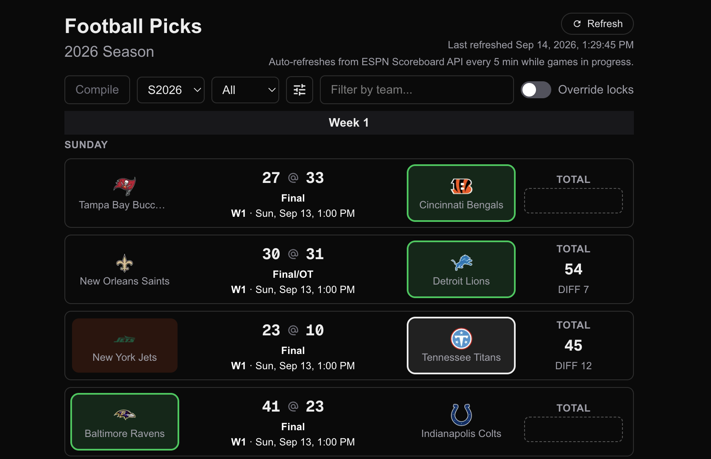
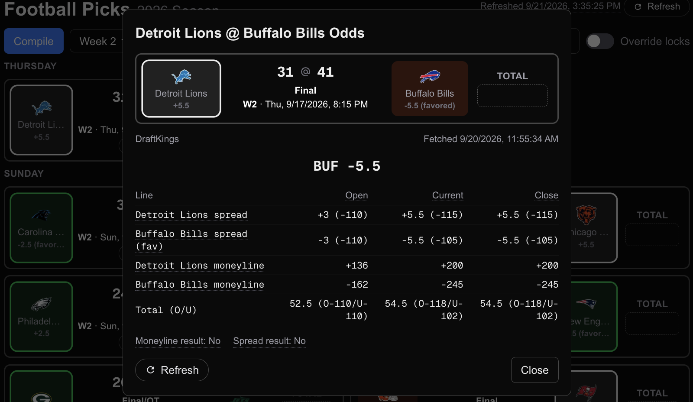
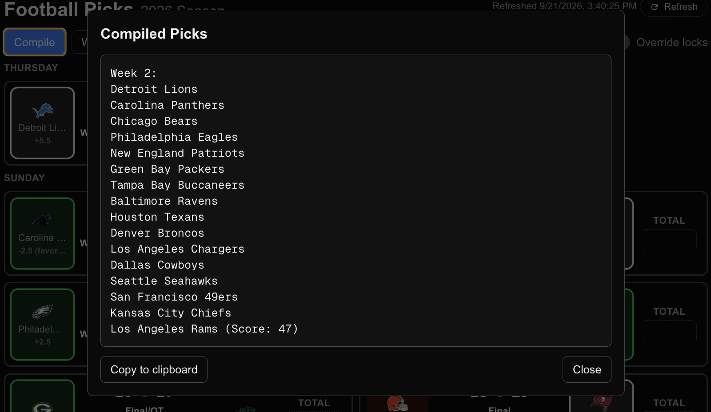
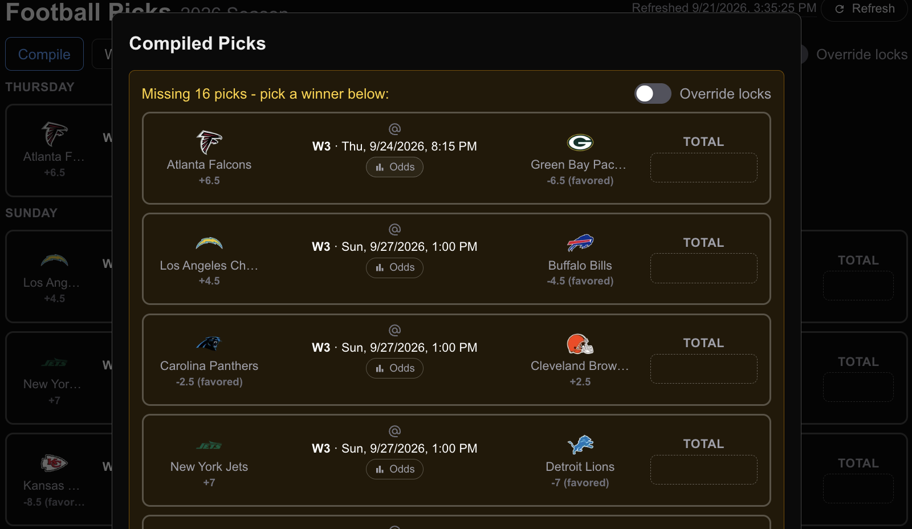

# Football Picks



A [NextJS](https://nextjs.org) app for a personal NFL "pick 'em" tracker:
pick the winner of every game each week, optionally add a tiebreaker score-total guess,
and see it all laid out by season and week.

## Features

- **Weekly schedule**, pulled live from ESPN's public scoreboard API. There is
  no database: the page fetches the week it needs (or a whole season, on
  request) and keeps it in memory for the session.

- **Pick a winner** for each game, plus an optional score-total tiebreaker
  entry. Picks are saved in your browser (localStorage), which is the only
  thing that persists between visits.

- **Picks lock at kickoff**, with a manual override toggle for correcting a
  pick on an in-progress game.

- **Filters** for team, game status (upcoming/in-progress/final), and game
  day, plus bye-week callouts per week.

- **Live refresh status** showing when scores were last synced from ESPN,
  with a manual refresh button.

- **Betting odds**, pulled from ESPN's public API. Current spreads, moneylines,
  and expected score total are displayed in a separate modal per game,
  accessible from each game list item.
  The favored team to win is indicated, and the current spread is pulled into
  the selector for the team within the game list.

  

- **Compile view**: turns a week's picks into a plain-text list, ready to
  copy and paste elsewhere:

  

  If any teams have not yet been selected,
  this view shows their game list items, allowing for quick entries without leaving the modal:

  

  You can open Odds for a game from within this modal, as well.
  Modals stack, so closing the Odds modal will not close the Compiled modal behind it!

- **Export, import, and clearing** of stored picks from the **Data** menu (the
  floppy-disk button): save one season to a JSON file, merge a file back in, or
  delete a week, a season, or everything after a confirmation.

- **All client side, no logins needed**: I don't want your data. All API calls to ESPN
  and every game pick you make keep data stored locally in your browser session.
  If you want to preserve that data and move to some other device,
  use the Export/Import feature (above).

## Getting Started

This project uses [`just`](https://just.systems) as its command runner. If
you don't already have it, install it (e.g. `brew install just`).
You can also fallback to `pnpm` commands as listed below.

First, bootstrap the dev environment (installs dependencies, pre-commit
hooks, and generates Next's type stubs):

```shell
just bootstrap
# or, without just:
pnpm install
```

Then start the dev server:

```shell
just up
# alias:
just dev

# or, without just:
pnpm dev
```

Open [http://localhost:3000](http://localhost:3000) to see the running site.

> [!NOTE]
> If port 3000 is in use by some other process,
> NextJS may try to automatically launch the server on port 3001, instead.
>
> In that case, just go there: [http://localhost:3001](http://localhost:3001)

### Where the data lives

Only your picks persist, written to this browser's localStorage as you click.
The schedule, bye weeks, and odds are fetched from ESPN on each visit and
kept in memory for that session, so closing the tab throws them away and the
next visit re-checks ESPN.

The page opens on the current week (one ESPN request). Pick another week from
the week selector, or "All" for the whole season. Past seasons default to
"All", since looking back usually means looking at everything.

While games are in progress, the page re-checks ESPN once every 5 minutes,
or on demand from the top-right of the page.

### Export, import, and clearing

The **Data** button (floppy disk, next to Filters) works on the stored picks:

- **Export** downloads the selected season's picks as
  `football-picks-S2026-<timestamp>.json`: a plain array of
  `{ gameId, season, team, teamName, scoreTotal }` rows, sorted so two exports
  of the same picks are identical files.
- **Import** takes a file in that shape and merges it into this browser's
  picks. Rows for games already picked overwrite those fields, anything the
  file doesn't mention is left alone, and malformed or duplicate rows are
  skipped and counted rather than failing the whole file.
- **Clear** deletes the week on screen (the default), the selected season, or
  every pick, behind a confirmation that shows how many rows go.

Picks live per browser, so exporting is also how you move them to another
machine.

> [!NOTE]
> The ESPN Scoreboard API may only show details of the current season.
>
> This is only tested (so far) on the current 2026 NFL season;
> YMMV next year.

## Development

### Building the static site

To build the static site and make it ready to deploy, simply run:

```shell
pnpm build
```

All content is compiled to `out/` directory (gitignored).
Copy to any static host or CDN as you like.

No server process is required: the browser calls ESPN's API from the client,
and all other data is stored in the local browser session.

## Why?

For fun. 🙂

I have relatives and friends who run friendly pools to pick winners,
not getting involved in fantasy football.
We pick our winners and tell each other.
This just helps me do that in the geekiest way I know how.

## AI contribution note

I used Claude (Sonnet 5) for much of the initial development work.
I further used OpenCode's free models for adjustments later on.

This is a hobby project, after all.
None of this code is that original or groundbreaking,
no I probably don't fully understand all of it,
and no I don't exactly care to.

If you spot something sloppy and have a suggestion to improve it,
let me know in an issue or PR!
But please don't make massive AI overhaul changes:
I will just reject them at my discretion.
